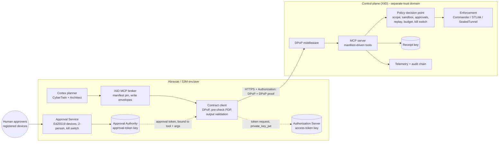
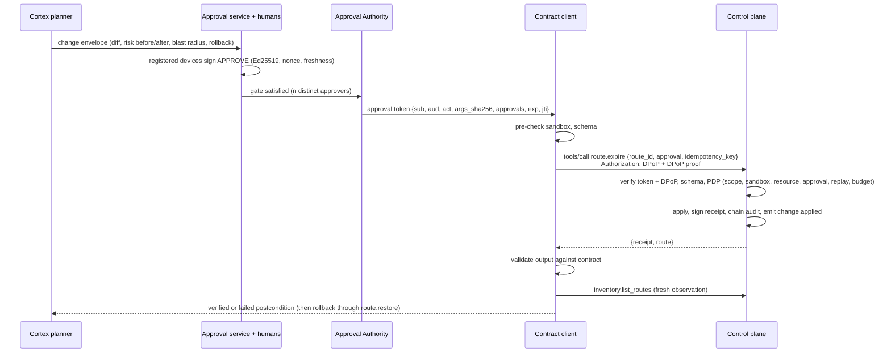

# S3M Cortex control-plane MCP architecture (contract v0.1)

**Status:** Abraxas-owned proposal, implemented end to end in the synthetic range.
Tools marked *proposed* in [TOOLS.md](TOOLS.md) **require XiiD validation** before any
live use. Nothing here has been run against a real XiiD deployment.

## 1. Purpose

Cortex (S3M) decides *which* security changes to make, *in what order*, and *with what
approval*, and then proves the result from independent observation. A control plane
(first target: XiiD Commander / STLink / SealedTunnel) enforces those changes.
This contract defines the interface between the two, so that:

- the AI layer never holds write authority;
- every consequential change is approved by humans through an authority Cortex does not control;
- the control plane can refuse anything outside an explicitly granted sandbox, independently of the client;
- both sides are generated from one signed manifest, so drift is detected before it causes harm.

## 2. Components and trust boundaries

| Boundary | What crosses it | What protects it |
|---|---|---|
| Planner → broker | Logical actions (`expire_route`) | Tool map; bound HMAC write envelopes; manifest digest re-checked on every call |
| Broker → contract client | Tool name, arguments | Client-side PDP pre-check (sandbox, scope, resources); input schema validation |
| Client → control plane | MCP over streamable HTTP | 5-minute EdDSA access token, audience-bound (RFC 8707) and DPoP-bound (RFC 9449) |
| Control plane → client | Results | Output schema validation (no extra fields, length limits); untrusted-text marking; signed receipts |
| Humans → control plane | Approval | Ed25519 approval token from the Approval Authority, bound to client, tool, argument digest; ≤ 900 s; single use |

## 3. Three independent keys

| Key | Held by | Signs | A compromise alone allows |
|---|---|---|---|
| Access-token key | Authorization Server | Who the client is, which sandbox and scopes | Reads within one sandbox. No writes: writes need an approval token too. |
| Approval key | Approval Authority (behind the device approval service) | That humans approved *this* tool with *these* arguments | Nothing on its own: it is useless without a DPoP-bound access token for the named client. |
| Receipt key | Control plane | What was actually applied | Forged receipts. Cortex re-verifies from observed state anyway. |

Cortex holds only its own client key (to prove identity and sign DPoP proofs). It cannot
mint access tokens or approvals. Compare with the current broker, where the write-envelope
HMAC key is shared with Cortex, so the server must trust the client.

## 4. A write, end to end

## 5. Manifest

- One file: `src/cortex/mcp_contract/schemas/v0.1/manifest.json`, generated by
  `python -m src.cortex.mcp_contract.contract_spec` (byte-stable; CI checks it is current).
- 25 tools: 11 read (A), 3 simulate (B), 6 class-C writes, 5 class-D writes. See [TOOLS.md](TOOLS.md).
- Every tool schema is **self-contained JSON Schema 2020-12**. Each tool bundles its own
  `$defs`, because MCP SDK clients validate results against the advertised `outputSchema`
  and do not resolve cross-document references. `common.schema.json` remains the shared library.
- Every object schema sets `additionalProperties: false`. Free text from outside S3M is
  typed `UntrustedText` (≤ 280 characters), so the planner can treat it as data.
- Writes always require `approval` and `idempotency_key`, return a signed `receipt`, and
  declare `min_approvals`, reversibility, and the inverse tool.
- The contract authority signs `contract|version|sha256`. The client pins the signature
  and digest, then compares every advertised tool's description and input and output
  schemas with the manifest. Any difference, including a mid-session "rug pull", stops the client.

## 6. Where it is implemented

| Piece | Path |
|---|---|
| Contract source, generator, tool reference | `src/cortex/mcp_contract/contract_spec.py`, [TOOLS.md](TOOLS.md) |
| Manifest loading, validators, signing | `src/cortex/mcp_contract/manifest.py` |
| Authentication (AS, DPoP, approvals) | `src/cortex/mcp_contract/tokens.py`, see [AUTH.md](AUTH.md) |
| Policy decision point, sandboxes | `src/cortex/mcp_contract/authz.py`, `configs/cortex/mcp_sandboxes.yaml`, see [SANDBOXES.md](SANDBOXES.md) |
| Telemetry generator | `src/cortex/mcp_contract/telemetry.py`, see [TELEMETRY.md](TELEMETRY.md) |
| Contract client (`MCPTransport`) | `src/cortex/mcp_contract/client.py` |
| Reference control plane (range only) | `range/contract_server/app.py` |
| Cycle over the contract | `range/run_contract_cycle.py`, tool map `configs/xiid_tool_map.contract_v0_1.yaml` |
| Tests | `tests/cortex/test_mcp_contract.py` |

## 7. Measured in the range (synthetic data, simulated approvers, no language model)

| Run | Outcome |
|---|---|
| c-SIM-002 via `sbx-change-limited` | Verified. 4 writes, 4 signed receipts, 0 denials, observed risk = predicted (0.923 → 0.822). |
| c-SIM-005 (second write acknowledged but not applied) | Rolled back. Includes undoing a route **expiry** through `route.restore`, which the current XiiD tool set cannot do. Risk restored exactly to baseline. |
| Boundary tests | Bearer-only and unauthenticated requests get 401. Stolen token without key, replayed DPoP proof, wrong `htu`: refused. Approval for other args, tool or client, or forged: refused. Approval reuse, sandbox resource violation, kill switch, ninth write in the hour: refused with the specific code. Rug pull: detected. |

## 8. Questions this contract puts to XiiD

1. Can the control plane implement `route.restore`, `stlink.enable`, `host.release`, `access.revoke` (inverses)?
2. Can it verify Approval Authority tokens itself, so it does not have to trust the client?
3. Will it accept DPoP-bound tokens from an Abraxas or customer authorization server, or does it need to issue its own?
4. Can it serve flow summaries and typed events (TELEMETRY.md), or only raw inventory?
5. Can it host a dedicated sandbox tenant with the profile in [SANDBOXES.md](SANDBOXES.md) §4?
