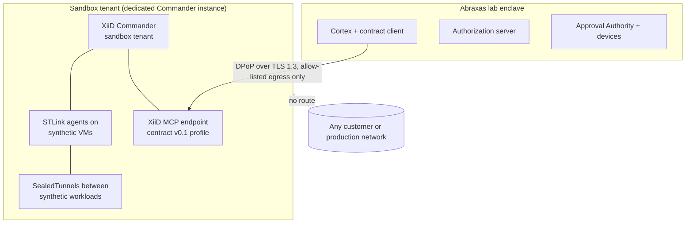

# Read/write permission sandboxes - S3M Cortex MCP contract v0.1

**Status:** profiles enforced by the reference control plane and pre-checked by the
Cortex client. The deployment in §4 is **hypothetical**: a proposal for a XiiD sandbox
tenant, not an existing environment.

## 1. Model

Three independent questions decide every call:

| Question | Decided by | Granularity |
|---|---|---|
| What *class* of action may this client attempt? | Scopes in the access token | A / B / C / D |
| *Where* and *how much*? | The sandbox named in the token | Tool names, resource ids, budget, rate |
| *Whether* this specific change happens | Approval token | One tool, one argument set, ≤ 900 s, single use |

A token names exactly one sandbox. Selectors are glob patterns over resource ids. **Deny
beats allow; no matching allow means deny.** Profiles live in
`configs/cortex/mcp_sandboxes.yaml`.

## 2. Profiles

| Profile | Scopes | Tools | Write targets | Writes per hour | Calls per minute | Notes |
|---|---|---|---|---|---|---|
| `sbx-observe` | read | all class A | none | 0 | 120 | Default for any new integration |
| `sbx-simulate` | read, simulate | A + B | none | 0 | 120 | Dry-run impact and policy, drafts |
| `sbx-change-limited` | read, simulate, write.c | A + B + `route.narrow/restore/expire` | Routes `rt-users-*`, `rt-inet-*`, `rt-mail-*`, `rt-cams-*`, `rt-erp-hrdb`, `rt-ci-dc`; **never** `rt-users-dc`, `rt-jump-*`, `rt-admins-*`, `rt-backup-*` | 8 | 60 | Every change must have an inverse; first live-write profile |
| `sbx-range-full` | all | all | All routes and STLinks; hosts except `srv-dc-*`, `srv-pki-*` | 40 | 240 | Synthetic range only; `environment: range` |
| `sbx-agent-untrusted` | read | `contract.manifest`, `inventory.list_routes`, `telemetry.health` | none | 0 | 10 | AgentShield profile for third-party agents; `user` fields redacted; all free text tainted |

## 3. Read and write permission matrix (`sbx-change-limited`)

| Resource | Read | Simulate | Write |
|---|---|---|---|
| Routes, user/perimeter/legacy | yes | yes | narrow, restore, expire (1 approval each) |
| Routes, identity, jump-host, admin, backup | yes | yes (simulation reports the refusal) | **no** |
| STLinks, SealedTunnels | yes | yes | no |
| Hosts, sessions | yes | yes | no |
| Temporary access grants | no | no | no |
| Findings, telemetry, audit | yes | n/a | n/a |

`policy.simulate` evaluates proposed changes against the caller's own sandbox, so an
operator can see *before approval* which changes the control plane would refuse.

## 4. Hypothetical XiiD sandbox deployment

**Goal:** run the Cortex cycle against real XiiD software with zero path to production.

| Control | Requirement |
|---|---|
| Tenancy | A dedicated Commander tenant; no shared policy store with any customer tenant |
| Workloads | Synthetic VMs and containers generated from `range/enterprise/generator.py`, mirroring `enterprise_200` (200 hosts, 20 servers, 10 apps) |
| Network | A separate VLAN or cloud project; default-deny egress except to the Abraxas lab IP set; no peering |
| Identity | Sandbox-only AS client registrations; the Approval Authority key is distinct from any production key |
| Profiles | Start at `sbx-observe` → `sbx-simulate` → `sbx-change-limited`; never `sbx-range-full` |
| Kill switch | Two named holders (one Abraxas, one XiiD); engaging it halts all writes immediately |
| Evidence | Control-plane receipts + audit-chain head exported daily; Cortex Merkle log retained |
| Data | No customer data, credentials or real CVEs; findings use the `SYN-` prefix |

**Entry criteria for each step:**

1. `sbx-observe`: manifest pins (signature and digest); all read tools return
   schema-valid output for 24 h; telemetry validates against `telemetry.schema.json`.
2. `sbx-simulate`: `change.impact` and `policy.simulate` agree with the Cortex twin on the SIM-002 plan.
3. `sbx-change-limited`: SIM-002 verified (observed = predicted) and SIM-005 rolled back
   on XiiD software; every refusal code in [AUTH.md](AUTH.md) §5 demonstrated once; zero
   writes outside selectors in the audit chain.

## 5. Reference behaviour (tests)

`tests/cortex/test_mcp_contract.py` demonstrates each boundary against the reference
control plane:

- the untrusted profile is refused `inventory.list_hosts`, both client-side and server-side;
- an identity route is refused with `RESOURCE_DENIED` despite a valid approval;
- the ninth write in an hour gets `WRITE_BUDGET_EXHAUSTED`;
- the kill switch blocks writes;
- a class-D tool under `sbx-change-limited` gets `FORBIDDEN_SCOPE`.
