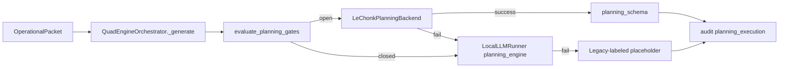

# Le Chonk Phase 4 — integration report

**Date:** 2026-11-07  
**Branch:** `cursor/le-chonk-phase4-vllm-integration-6ed4`  
**Status:** Code-complete for review — **no production routing, no weight download, no GPU provisioning**

## Executive summary

Phase 4 connects the quad-engine `planning_engine` logical role to `LeChonkPlanningBackend` (private vLLM) inside `QuadEngineOrchestrator._generate()`, behind fail-closed gates. Legacy Mixtral GGUF and deterministic placeholders remain the default production path. Mock vLLM integration tests exercise happy-path inference, structured COA parsing, backend failure, and circuit-open fallback without touching quarantined weights.

## Deliverables

| # | Requirement | Implementation |
|---|-------------|----------------|
| 1 | Orchestrator ↔ Le Chonk | `planning_generation.py` called from `orchestrator._generate()` for `planning_engine` outputs |
| 2 | Preserve four logical engines | Tactical/reasoning/Arabic paths unchanged; only planning branch extended |
| 3 | Gated routing | `planning_gates.py` aggregates feature flag, manifest execution, admission, runtime smoke, scheduler profile, security |
| 4 | Structured planning + schema | `planning_schema.py` (Pydantic COA envelope) |
| 5 | Clear fallback labeling | `[LEGACY FALLBACK — not Le Chonk inference]` on placeholder path; audit `output_origin` |
| 6 | Provenance / audit / classification | `planning_execution` block on quad-engine audit records; `classification` preserved on audit |
| 7 | R2 acquisition verification | `r2_acquisition.py` + `scripts/integrations/lechonk/verify_r2_acquisition.py` (LIST/HEAD metadata only) |
| 8 | Multi-file admission hardening | Inventory signature verification in `ModelAdmissionGate.evaluate_shard_inventory` |
| 9 | Mock vLLM orchestrator tests | `test_planning_orchestrator_integration.py` |
| 10 | Failure scenario tests | Fallback, circuit-open coverage in orchestrator + existing backend tests |
| 11 | Test execution | See below |
| 12 | This report | Current document |

## Architecture (planning path)



## Production posture (unchanged)

- `S3M_LECHONK_ENABLED` default **false**; `execution_enabled: false` in `mistral_large_4.yaml`
- `quad_engine_map.planning_engine` remains **`mistral`**
- `mistral_large_4` engine status **quarantine** / not routable
- No R2 object downloads; verification uses list/head metadata only
- No Hetzner/Docker restarts, no GUI changes, no training/GPU starts

## R2 verification (gate A staging)

| Variant | Expected objects (manifest) | Lab fixture shards | Production action |
|---------|----------------------------|--------------------|-------------------|
| `fp8_gpu` | 69 | 2-row lab JSON | Run `verify_r2_acquisition.py` with vault credentials; report must show 69/69 |
| `nvfp4_blackwell_gpu` | 44 | 2-row lab JSON | Same for NVFP4 prefix |

Multipart S3/R2 ETags are flagged as untrusted SHA-256 evidence; operators must supply `Metadata.sha256` or match signed inventory digests.

## Test execution (agent run 2026-11-07)

```bash
python3 -m pytest tests/integrations/lechonk tests/test_quad_engine.py tests/test_vllm_backend.py -q
```

**Result:** `53 passed` (2 pytest config warnings).

**Skipped / not run:**

| Suite | Reason |
|-------|--------|
| `tests/cortex/test_model_admission.py` | Parent `tests/cortex/conftest.py` imports optional `mcp` (not installed in agent VM) |
| Live R2 integration | No vault credentials in agent environment (script exits 2 by design) |
| Real vLLM / weights | Explicitly prohibited for this phase |

## Rollback

1. Unset `S3M_LECHONK_ENABLED` and `S3M_LECHONK_RUNTIME_SMOKE_PASSED`
2. Keep `planning_engine → mistral` binding
3. Remove optional `configure_planning_integration` hooks (test-only; no production callers)

## Follow-ups (post-Phase 4, human gates)

- Gate A: full 69/44 signed inventories promoted from R2 metadata audit
- Gate B–C: production admission signature via vault key; GPU smoke with pinned `S3M_LECHONK_VLLM_BUILD`
- Gate E canary: flip `quad_engine_map.planning_engine` only after acceptance signoff
